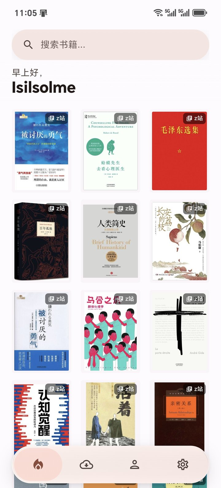
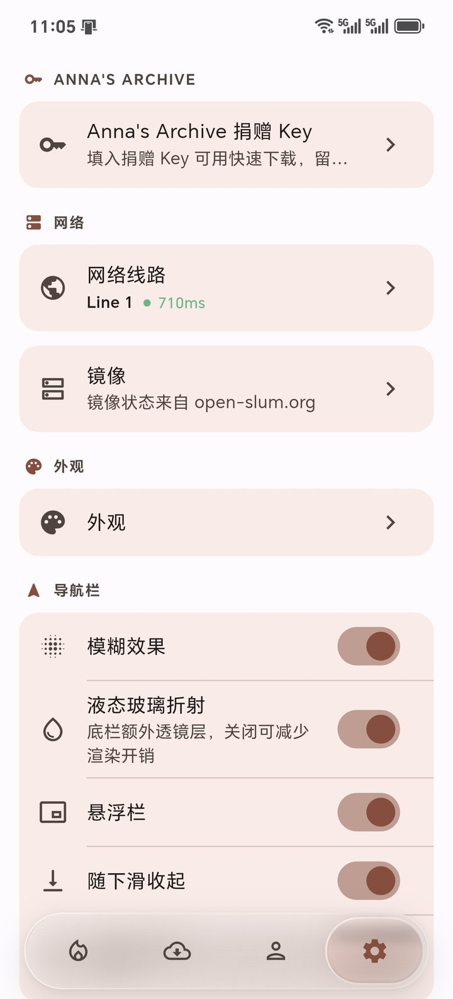
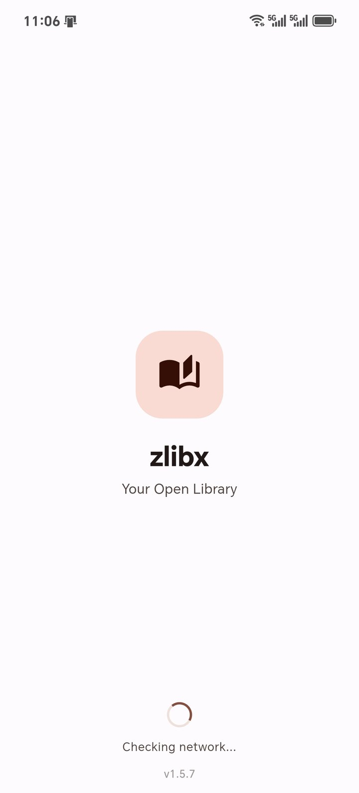

# 📚 zlibx-MD3

> The application name remains **zlibx**; this repository is the independent Material 3 / liquid-glass edition.

<div align="center">


**A slim, Android-only ebook reader with a liquid-glass interface — 64-bit, no AI features, no WeRead**

**Third-party client • Frontend only • All data from external sources**

[Download](https://github.com/Isilsolme/zlibx-MD3/releases) • [Report Bug](../../issues) • [Request Feature](../../issues)

**English** | **[简体中文](README_ZH.md)** | **[日本語](README_JA.md)** | **[한국어](README_KO.md)**

</div>

---

> ⚠️ **Disclaimer**: zlibx is an independent, open-source third-party client. It is NOT an official client and is not affiliated with any official service. This project only provides the frontend interface — all book data comes from external sources. Use at your own discretion.

## 📱 Screenshots

| Home · 3-column feed | Settings · navigation | Clean MD3 splash |
|:---:|:---:|:---:|
|  |  |  |

## ✨ Highlights

- **Liquid-glass navigation bar** — a draggable lens that follows the finger, springs between tabs, and can be switched to a plain color mask. Optional refraction, floating mode, hide-on-scroll, and Always / Auto / Never labels. On tablets (≥ 600 dp) the same destinations move into an opaque vertical rail on the left, so the glass stays a phone-only effect.
- **Adaptive grid** — the home grid asks the window how many columns fit: 3 on a phone, 4–8 on a tablet, still overridable to 2 or 3 in Settings.
- **Warm-start home feed** — the last 60 books are cached in Hive, so a cold launch paints the grid immediately; the skeleton only appears on a true first launch.
- **Infinite recommendations** — recommendations roll into popular → newest → publish-year pages, with pull-to-refresh that prepends genuinely new books.
- **Progressive blur header** — a real fragment-shader gradient blur (no banding, no hard edge) under the home header.
- **App-open book transition** — the card cover flies into the detail cover (Hero) while the detail page fades in over the grid.
- **Unified sources and search** — Z-Library, Anna’s Archive and LibGen in one search screen, with language / format / sort filters, recent searches and suggestions.
- **Material 3 throughout** — filled cards and chips, no decorative outlines, right-side popovers for theme and language, a dedicated Navigation settings section.
- **Cleaner structure** — the home, book card and search filter UI were split into focused widgets; dead providers were removed and the feed’s rebuild scope was narrowed.

## 🧭 Features

| Feature | Description |
|---------|-------------|
| 📚 **Multi-source search** | Z-Library, Anna’s Archive and LibGen; title/author/ISBN search, language/format/sort filters |
| 🏠 **Infinite home feed** | Recommendations plus paged popular/newest/year lists; adaptive grid (3 columns on phones, up to 8 on tablets); pull-to-refresh |
| ⚡ **Warm start** | Hive-backed feed cache (60 books, 7 days) and a 15-minute background refresh policy |
| 🌊 **Liquid-glass navigation** | Draggable lens, spring/haptics, optional refraction, floating bar, hide-on-scroll, label modes; on tablets an opaque left rail replaces it |
| 🕘 **Viewing history** | Books whose detail page was opened on this device, newest first, deduplicated, 200-entry cap, clearable |
| 📥 **Resumable downloads** | Ongoing/completed tabs, Range resume, stable .part files, mirror-aware source resolution |
| 🔐 **Multi-account** | Credentials in Android Keystore-backed secure storage; account-scoped caches |
| 🌐 **Multi-domain** | Built-in and community lines, speed test, trust prompts before credentials are sent |
| 🌍 **5 languages** | English, 简体中文, 繁體中文, 日本語, 한국어 |
| 🎨 **Material 3 UI** | Filled surfaces, tonal buttons/chips, 28dp sheets, theme and language popovers |
| 🚫 **No AI, no ads, no WeRead** | No subscriptions, no hidden costs, no AI/WeRead integrations |

## ✂️ About this fork

zlibx-MD3 is maintained independently from [minglaiyo/zlibx](https://github.com/minglaiyo/zlibx) (the slim fork of [shiyi-0x7f/olib-mobile](https://github.com/shiyi-0x7f/olib-mobile)). The app name stays **zlibx**; this fork owns the UI/motion work and ports upstream fixes selectively.

- Android only, 64-bit (`arm64-v8a`) only
- AI features removed (prescriber, AI search, backend auth)
- WeRead removed
- The original private API plugin was rewritten from scratch in `vendor/olib_api_plugin`
- UI and motion rebuilt around Material 3 and a custom liquid-glass navigation bar
- Anna’s Archive / LibGen sources and the external download resolver added

## 🏗️ Architecture and performance

- **State** — Riverpod providers; large screens subscribe to only the fields they paint (the home grid does not rebuild when pagination flags change).
- **Storage** — Hive for settings/caches; `flutter_secure_storage` for credentials. The home feed cache is account-cleared and capped at 60 books.
- **Networking** — shared Dio factory; single-stream resumable downloads with `.part` metadata; mirror trust checks.
- **Rendering** — `ProgressiveBlur` (fragment-shader backdrop filter) for the header; a custom `LiquidNavBar` with spring physics and `BackdropFilter`; Hero + fade for book opening.
- **Structure** — the home host, Recommended tab and bar; the book card and its cover; the search filter sheet are separate widgets, so layout, cover caching and filter state can change independently.

## 🚀 Quick Start

### Prerequisites

- Flutter **3.44+** (Dart **3.10+**)
- JDK **21**
- Android SDK with build tools; the project uses `compileSdk 37`
- An Android device or emulator (arm64)

### Run

```bash
git clone https://github.com/Isilsolme/zlibx-MD3.git
cd zlibx
flutter pub get
flutter run
```

### Build

```bash
# Local performance build (what the current test APKs use)
flutter build apk --profile --target-platform android-arm64

# Release (requires android/key.properties + keystore; never commit them)
flutter build apk --release --target-platform android-arm64
```

Release signing is intentionally strict: the Gradle build refuses to sign a release with the debug key. Add `android/key.properties` pointing at your keystore (see `android/app/build.gradle.kts`).

### Checks

```bash
flutter analyze
flutter test
```

## 📂 Project Structure

```
lib/
├── constants/      # Search filters and app constants
├── core/           # Book data, mirrors, Anna/LibGen parsing helpers
├── l10n/           # Hand-written localization (5 languages)
├── models/         # DisplayBook, nav label mode, etc.
├── providers/      # Riverpod state (auth, feed, downloads, settings)
├── routes/         # Named routes
├── screens/        # Home (host/tab/bar), search, detail, downloads, settings
├── services/       # API, Hive cache, downloads, trust, WebView challenges
├── theme/          # Material 3 light/dark themes
├── utils/          # Snackbars, diagnostics, image cache helpers
└── widgets/        # BookCard + cover, liquid nav/segmented control, sheets

docs/screenshots/   # README screenshots
test/               # parsers/, services/, widgets/
vendor/
└── olib_api_plugin/ # In-repo Z-Library API client
```

## 🛠️ Tech Stack

- **Framework**: Flutter 3.44 (Material 3)
- **State**: Riverpod (classic `Notifier` / `NotifierProvider`)
- **Storage**: Hive + `flutter_secure_storage`
- **HTTP**: Dio; `package:http` only for suggestions/update checks
- **Images**: `cached_network_image` with decoded-size-aware cache keys
- **Blur**: `liquid_glass_widgets` `ProgressiveBlur` (MIT) as a backdrop fragment shader
- **Localization**: hand-written maps, no code generation
- **Tests**: parser, service and widget tests (`flutter test`)

## 🤝 Contributing

Contributions are welcome. Please keep the existing layering and the “no code generation” rule:

1. Fork the project
2. Create a feature branch (`git checkout -b feature/AmazingFeature`)
3. Run `flutter analyze` and `flutter test`
4. Commit and open a Pull Request

## 📄 License

This project is licensed under the GNU Affero General Public License v3.0 (AGPL-3.0) — see [LICENSE](LICENSE). Portions derived from shiyi-0x7f/olib-mobile remain under the MIT License (preserved in the LICENSE file).

> ⚠️ **Legal Notice**:
> - This is an independent third-party client, NOT an official application
> - All book data comes from external sources; this project provides frontend only
> - Users are responsible for ensuring compliance with applicable laws
> - By using this software, you acknowledge these terms

## 💖 Acknowledgments

- Based on [shiyi-0x7f/olib-mobile](https://github.com/shiyi-0x7f/olib-mobile) (MIT), slimmed down
- Anna’s Archive / LibGen sources from [warreth/OpenlibExtended](https://github.com/warreth/OpenlibExtended) (AGPL-3.0)
- [liquid_glass_widgets](https://github.com/sdegenaar/liquid_glass_widgets) by Sebastian Degenaar (MIT) for the `ProgressiveBlur` shader
- 💙 Flutter framework
- ❤️ Open source community

---

<div align="center">

**[⬆ Back to Top](#-zlibx)**

Open Source • Free Forever

</div>
