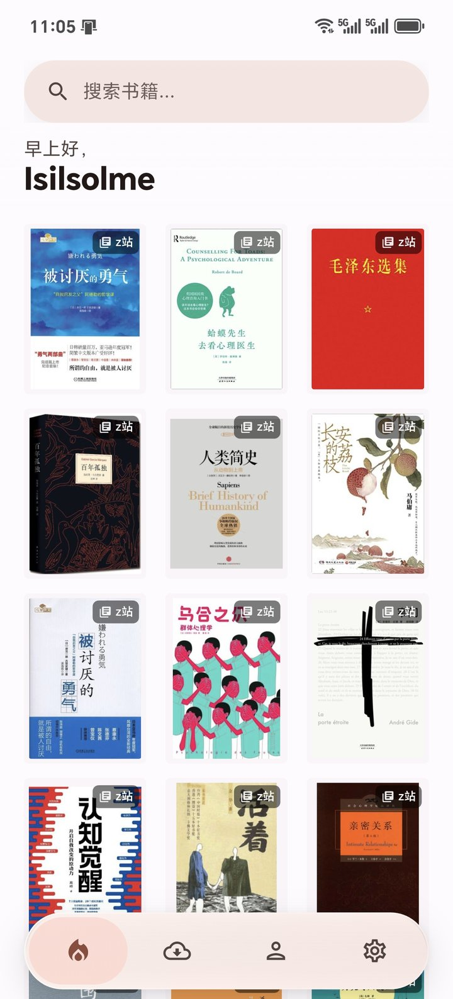
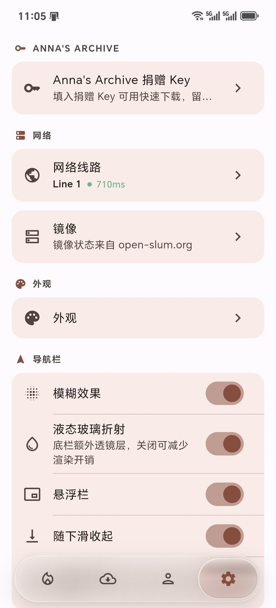
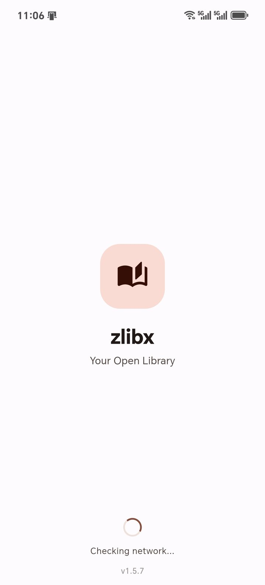

# 📚 zlibx

<div align="center">


**精简的纯安卓电子书阅读器，液态玻璃导航 —— 仅 64 位，无 AI 功能，无微信读书**

**第三方客户端 • 仅提供前端界面 • 数据来自外部源**

[下载 APK](https://github.com/Isilsolme/zlibx-MD3/releases) • [报告问题](../../issues) • [功能建议](../../issues)

**[English](README.md)** | **简体中文** | **[日本語](README_JA.md)** | **[한국어](README_KO.md)**

</div>

---

> ⚠️ **免责声明**: zlibx 是一个独立的开源第三方客户端，**不是**官方客户端，与任何官方服务无关。本项目仅提供前端界面，所有书籍数据来自外部源。请谨慎使用。

## 📱 截图

| 首页 · 三列推荐 | 设置 · 导航栏 | MD3 启动页 |
|:---:|:---:|:---:|
|  |  |  |

## ✨ 更新亮点

- **液态玻璃导航栏** —— 透镜跟手拖动、弹簧吸附、可切换为纯色遮罩；支持折射、悬浮、下滑收起，以及始终/自动/不显示文字。
- **首页热启动** —— 最近 60 本书缓存到 Hive，冷启动直接显示网格；骨架屏只在真正首次启动时出现。
- **无限推荐流** —— 推荐流滚动到末尾后自动接 popular → 最新 → 出版年份，下拉刷新会把真正的新书插到顶部。
- **渐变模糊顶栏** —— 用 fragment shader 实现真正的连续渐变模糊，没有分层，也没有硬边。
- **开书动画** —— 卡片封面通过 Hero 飞到详情页封面，详情页在网格上方淡入。
- **统一书源与搜索** —— Z-Library、Anna’s Archive、LibGen 共用搜索页，支持语言/格式/排序过滤、最近搜索、输入建议。
- **全面 Material 3** —— 填充式卡片和 Chip、去装饰描边、主题/语言右侧小浮窗、独立的“导航栏”设置分区。
- **结构精简** —— 首页、书籍卡片、搜索过滤弹窗拆成独立组件；删除无引用的 provider，缩小首页重建范围。

## 🧭 功能特点

| 功能 | 说明 |
|------|------|
| 📚 **多源搜索** | Z-Library、Anna’s Archive、LibGen；书名/作者/ISBN，语言/格式/排序过滤 |
| 🏠 **无限首页流** | 推荐 + popular/最新/出版年份分页；三列网格；下拉刷新 |
| ⚡ **热启动** | Hive 缓存最近 60 本（7 天），15 分钟后台刷新策略 |
| 🌊 **液态玻璃导航** | 可拖动透镜、弹簧/触感、可选折射、悬浮栏、下滑收起、文字模式 |
| 📥 **断点下载** | 进行中/已完成双栏、Range 续传、稳定 .part 文件、按线路解析 |
| 🔐 **多账号** | 凭据存 Android Keystore 安全存储；缓存按账号隔离 |
| 🌐 **多线路** | 内置/社区线路、测速、登录前线路信任确认 |
| 🌍 **5 种语言** | English、简体中文、繁體中文、日本語、한국어 |
| 🎨 **Material 3 界面** | 填充表面、tonal 按钮/Chip、28dp 弹窗、主题/语言浮窗 |
| 🚫 **无 AI、无广告、无微信读书** | 无订阅、无隐藏费用、无 AI/微信读书集成 |

## ✂️ 关于本精简版

zlibx 是 [shiyi-0x7f/olib-mobile](https://github.com/shiyi-0x7f/olib-mobile) 的魔改版：

- 仅安卓，仅 64 位（`arm64-v8a`）
- 已去除 AI 功能（寻书、AI 搜索、后端鉴权）
- 已去除微信读书
- 原私有插件已在本仓库内重写（`vendor/olib_api_plugin`）
- UI 与动效围绕 Material 3 和自定义液态玻璃导航栏重做
- 增加 Anna’s Archive / LibGen 书源与外部下载解析

## 🏗️ 架构与性能

- **状态** —— Riverpod；大页面只订阅实际绘制的字段（首页网格不会因为分页状态变化而整棵重建）。
- **存储** —— Hive 存设置/缓存，`flutter_secure_storage` 存凭据；首页缓存按账号清理，最多 60 本。
- **网络** —— 共享 Dio；单线程断点下载，`.part` 元数据；线路信任校验。
- **渲染** —— 顶栏用 `ProgressiveBlur`（fragment shader 背景滤镜）；自绘 `LiquidNavBar` 弹簧物理 + `BackdropFilter`；开书用 Hero + 淡入。
- **结构** —— 首页宿主/推荐页/导航栏、书籍卡片/封面、搜索过滤弹窗分别拆开，布局、封面缓存和过滤状态可以独立修改。

## 🚀 快速开始

### 环境要求

- Flutter **3.44+**（Dart **3.10+**）
- JDK **21**
- Android SDK 与 build tools；项目使用 `compileSdk 37`
- Android 设备或模拟器（arm64）

### 运行

```bash
git clone https://github.com/Isilsolme/zlibx-MD3.git
cd zlibx
flutter pub get
flutter run
```

### 构建

```bash
# 本地性能测试包（当前测试 APK 使用的方式）
flutter build apk --profile --target-platform android-arm64

# 正式 release（需要 android/key.properties + keystore，且不要提交）
flutter build apk --release --target-platform android-arm64
```

Release 签名是强制的：Gradle 不会用 debug key 签 release。请在 `android/key.properties` 指向自己的 keystore（参考 `android/app/build.gradle.kts`）。

### 检查

```bash
flutter analyze
flutter test
```

## 📂 项目结构

```
lib/
├── constants/      # 搜索过滤常量
├── core/           # 书籍数据、镜像、Anna/LibGen 解析
├── l10n/           # 手写多语言（5 种）
├── models/         # DisplayBook、导航文字模式等
├── providers/      # Riverpod 状态（账号、首页流、下载、设置）
├── routes/         # 命名路由
├── screens/        # 首页（宿主/推荐页/导航栏）、搜索、详情、下载、设置
├── services/       # API、Hive 缓存、下载、线路信任、WebView 挑战
├── theme/          # Material 3 明暗主题
├── utils/          # Snackbar、诊断、图片缓存工具
└── widgets/        # BookCard + 封面、液态导航/分段控件、弹窗

docs/screenshots/   # README 截图
test/               # parsers/、services/、widgets/
vendor/
└── olib_api_plugin/ # 仓库内 Z-Library API 客户端
```

## 🛠️ 技术栈

- **框架**: Flutter 3.44（Material 3）
- **状态**: Riverpod（经典 `Notifier` / `NotifierProvider`）
- **存储**: Hive + `flutter_secure_storage`
- **网络**: Dio；输入建议/更新检查使用 `package:http`
- **图片**: `cached_network_image`，按解码尺寸设置缓存
- **模糊**: `liquid_glass_widgets` 的 `ProgressiveBlur`（MIT），作为背景 fragment shader
- **本地化**: 手写 Map，无代码生成
- **测试**: parser、service、widget 测试（`flutter test`）

## 🤝 贡献

欢迎提交 PR。请保持现有分层，并遵守“不使用代码生成”的约定：

1. Fork 项目
2. 创建分支（`git checkout -b feature/AmazingFeature`）
3. 运行 `flutter analyze` 和 `flutter test`
4. 提交并打开 Pull Request

## 📄 许可证

本项目使用 GNU Affero General Public License v3.0（AGPL-3.0），见 [LICENSE](LICENSE)。来自 shiyi-0x7f/olib-mobile 的部分仍保留 MIT 许可证（见 LICENSE 文件）。

> ⚠️ **法律声明**:
> - 本项目是独立第三方客户端，不是官方应用
> - 所有书籍数据来自外部源，本项目仅提供前端
> - 用户需自行确保使用行为符合当地法律
> - 使用本软件即表示你知悉并接受这些条款

## 💖 致谢

- 基于 [shiyi-0x7f/olib-mobile](https://github.com/shiyi-0x7f/olib-mobile)（MIT）精简
- Anna’s Archive / LibGen 书源来自 [warreth/OpenlibExtended](https://github.com/warreth/OpenlibExtended)（AGPL-3.0）
- [liquid_glass_widgets](https://github.com/sdegenaar/liquid_glass_widgets)（MIT，作者 Sebastian Degenaar）提供 `ProgressiveBlur` shader
- 💙 Flutter
- ❤️ 开源社区

---

<div align="center">

**[⬆ 回到顶部](#-zlibx)**

开源 • 永久免费

</div>
